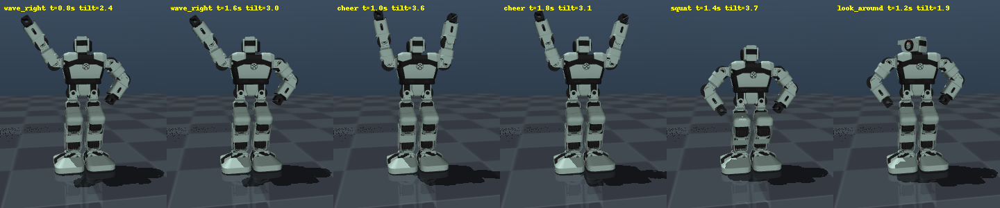

# yanshee_sim

A MuJoCo simulator, a ROS 2 description and sim-to-real tools for the **UBTECH Yanshee** humanoid
(17 servos, Raspberry Pi 3B + STM32, YanAPI REST on port 9090).

What you can do with it:

- **Simulate** the robot with the same servo names, angles and limits as YanAPI, so a motion file or a YanAPI
  script runs unchanged in simulation and on the robot.
- **Drive it from a web page** (laptop or tablet): walk, play built-ins and dances, pose the servos, record
  keyframes, read the IMU, speak, see through the cameras — in **Sim**, **Robot** or **Both** mode, every robot
  command passing a safety gate (limits, self-collision, speed cap, battery, gentle stops).
- **Mirror live** in either direction: the simulator copies the robot, or the robot follows the simulator.
- **Design and check motions** (pose editor, validation, self-collision sweep, free-standing physics), then run
  them on the robot slowly first.
- **Use the robot's own files**: its `.hts` motions load and play, and the sim walks with a tuned gait that
  stops without tipping over.
- **Measure what the sim still lacks** on the real robot with one command per measurement, following
  [docs/ROBOT_SESSION_PLAN.md](docs/ROBOT_SESSION_PLAN.md).

The design of the relay controller, REST client, web server and page is in
[docs/ARCHITECTURE.md](docs/ARCHITECTURE.md).



---

## Contents

1. [Quick start](#1-quick-start)
2. [Installation](#2-installation)
3. [How it works: the one rule](#3-how-it-works-the-one-rule)
4. [The web GUI](#4-the-web-gui)
5. [Command reference](#5-command-reference)
6. [Live mirroring: simulator ↔ robot](#6-live-mirroring-simulator--robot)
7. [Python API reference](#7-python-api-reference)
8. [Motion files (JSON and the robot's .hts)](#8-motion-files-json-and-the-robots-hts)
9. [Servo reference](#9-servo-reference)
10. [From simulation to the real robot](#10-from-simulation-to-the-real-robot)
11. [ROS 2](#11-ros-2)
12. [Rebuilding the model](#12-rebuilding-the-model)
13. [Tests](#13-tests)
14. [Accuracy, limits and what the documents say](#14-accuracy-limits-and-what-the-documents-say)
15. [Troubleshooting](#15-troubleshooting)
16. [Repository layout](#16-repository-layout)

---

## 1. Quick start

```bash
git lfs install                                   # once per machine: the Webots source model is stored with Git LFS
git clone git@github.com:youssefhindawi-cube/yanshee-sim.git && cd yanshee-sim
pip install -r requirements.txt                   # MuJoCo >= 3.3, numpy, the web GUI's FastAPI stack

python3 scripts/web_gui.py --host 127.0.0.1       # web GUI for the simulator at http://localhost:8080/ (this machine only)
python3 scripts/web_gui.py --viewer               # same, plus the MuJoCo 3D window on this laptop; the page can be a tablet
python3 scripts/view.py --fixed                   # just look at the model, drag joints by hand (torso held in the air)
python3 scripts/play_motion.py motions/wave_right.json   # check a motion file (limits, speed, self-collision) and watch it
python3 scripts/pose_editor.py --out motions/hello.json  # build a motion keyframe by keyframe while watching it
python3 tools/tune_gait.py --check                # 3 s: how fast and how stable the sim's walk is in 11 scenarios
python3 -m pytest -q tests                        # everything (about 5 minutes, headless)
```

With the robot on the same Wi-Fi (its IP is shown in the Yanshee app); nothing extra to install:

```bash
python3 scripts/mirror.py from-robot --ip 192.168.3.13      # FIRST on new hardware: the simulator copies the robot
python3 scripts/web_gui.py --ip 192.168.3.13                # GUI connected to the robot; switch to Robot/Both in the page
python3 scripts/play_motion.py motions/wave_right.json --real --ip 192.168.3.13 --speed 0.5   # run a checked motion, slowly
python3 tools/robot_checks.py latency --ip 192.168.3.13     # REST round-trip times (first of the measurements in docs/ROBOT_SESSION_PLAN.md)
```

---

## 2. Installation

| Need | Install |
|---|---|
| Everything | `pip install -r requirements.txt` |
| Simulator (required) | `mujoco>=3.3` (the code uses the `MjSpec` editing API) and `numpy`; tested with MuJoCo 3.8, Python 3.10. |
| Web GUI | `fastapi`, `uvicorn`, `websockets`, `Pillow` (`httpx` only for the server tests). |
| Real robot | Nothing extra: `RealRobot` talks to the robot's REST API with the standard library (`yanshee_sim/rest.py`). |
| `tools/robot_checks.py inspect` | `paramiko` (ssh into the Pi). The other modes need nothing extra. |
| `RealRobot.api` (optional) | The official `YanAPI.py`, for calls the package does not wrap. Needs `requests`, `nest_asyncio`, `opencv-python` and `export YANAPI_DIR=/folder/with/YanAPI.py` (default: `../yanshee robot/yanshee/yanshee_examples/yanshee_examples/`). |
| ROS 2 (optional) | ROS 2 Humble with `robot_state_publisher`, `joint_state_publisher_gui`, `rviz2`. |
| The model source | `git lfs install` before cloning, or `git lfs pull` afterwards; only needed to *rebuild* the model (`model/` is already generated). |

All commands are run from the repository root. Headless machines: `MUJOCO_GL=egl` for rendering.

---

## 3. How it works: the one rule

> **Simulated joint angle (radians) = real servo angle (degrees) converted to radians.**

- **Joint names:** the YanAPI servo names (`RightShoulderRoll` … `NeckLR`). **Limits:** the YanAPI servo limits.
- **Units in files and code:** servo **degrees**, the exact numbers `YanAPI.set_servos_angles()` takes. Nothing is converted between simulation and hardware.
- **Why it holds:** the model is UBTECH's Webots model of Yanshee; its saved joint positions are the servo angles in radians and reproduce the official reset pose.

The simulator runs physics **in real time in a background thread**, like the robot: `set_servos_angles(..., runtime)`
returns at once while the servos move over `runtime` ms, and `time.sleep()` in your scripts means the same on both.

---

## 4. The web GUI

```bash
python3 scripts/web_gui.py                                  # simulator, served to the whole LAN on port 8080
python3 scripts/web_gui.py --host 127.0.0.1                 # this machine only (recommended when no robot is connected)
python3 scripts/web_gui.py --viewer                         # also open the MuJoCo 3D window next to the server
python3 scripts/web_gui.py --ip 192.168.3.13                # connect the robot at start, stay in Sim mode until switched
python3 scripts/web_gui.py --mode both --ip 192.168.3.13    # start relaying every command to the simulator AND the robot
python3 scripts/web_gui.py --fixed                          # hold the simulated torso in the air (arm work, no falling)
python3 scripts/web_gui.py --motions-dir ~/shows            # keep the GUI's motion files elsewhere
```

| Option | Meaning |
|---|---|
| `--host` | Listen address. Default `0.0.0.0`: **anyone on the network can drive the robot**; `127.0.0.1` keeps it local. |
| `--port` | HTTP port (default 8080). |
| `--mode sim\|robot\|both` | Starting relay mode (default `sim`); `robot`/`both` need `--ip`. |
| `--ip IP[:PORT]` | Robot to connect at start (port 9090 by default). |
| `--viewer` | Also open the MuJoCo viewer window (see below). |
| `--fixed` | Hold the simulated torso in the air. |
| `--motions-dir DIR` | Folder of the GUI's motion files (default `motions/`). |
| `--log-level` | Server log level (default `info`). |

Exit code 2 if the port is busy or `--mode robot|both` cannot reach `--ip`. Ctrl+C stops everything (activity, robot
motions, renderer, simulator) and exits.

**What the page offers.** A **Sim / Robot / Both** switch, a big **STOP** (Esc, works even while a dialog is open),
Reset, Pause/Resume of a playing built-in, and these tabs:

| Tab | Contents |
|---|---|
| **Motion control** | Walk with the D-pad or the keys (hold to walk, release to stop; speed 1–5, side steps, arm swing); under the D-pad, **Rotate** ↺/↻ (hold, or <kbd>Q</kbd>/<kbd>E</kbd>: the simulator pivots slowly, the robot plays its own turn-around motion per press) and **Get up** (after a fall, chosen by the IMU: face down the robot's own Base_GetupF then reset, on its back GetupRear; the simulator plays the same two motions), plus two simulator-only **Tip over** buttons that push the robot over gently (front/back) so the fall detection and Get up can be tried; the robot's built-in actions grouped by category (gestures, locomotion, fight, football, get-up, dances with music, v2 layered, your motion files) with direction, speed and repeat. |
| **Servos & recorder** | 17 sliders by body part with live readback; limp/work per limb group (robot); capture keyframes with runtime and hold, edit and reorder them, preview in sim, play on the target, check report, save/load/delete motion files (JSON and `.hts`). |
| **Settings & sensors** | Volume, chest/eye LEDs, language, fall management, versions, the IMU numbers with a rolling chart (euler/gyro), add-on sensors, sim battery. |
| **Voice & vision** | TTS (the robot speaks; in sim the browser does), vision tasks with result cards (only colour detection works in sim), face entry, photo with resolution. |
| **Log** | The event stream. |

**Live view** (always visible): an MJPEG stream of the simulator from four cameras — *front*, *side*, *free* and
*head* (the robot's own point of view) — and the robot's real head camera in Robot/Both mode, plus LED indicators.

**Keys, from any tab** (not while typing in a field): arrows or <kbd>W</kbd><kbd>A</kbd><kbd>S</kbd><kbd>D</kbd> walk,
<kbd>Q</kbd>/<kbd>E</kbd> rotate, <kbd>Esc</kbd> is STOP. The same keys work in the MuJoCo window when the server runs
with `--viewer` (<kbd>X</kbd> or <kbd>Esc</kbd> there is STOP; the window must have the focus; a held key keeps the
walk alive, releasing it stops the walk within a second).

**Safety in Robot and Both mode.** Every command passes the gate: servo limits, self-collision check, a 90 °/s speed
cap (motion-file frames included), a 30 % battery floor, confirmation before limping leg servos. Walking has a
dead-man: a page that loses the server stops the robot within 1.5 s. Releasing the D-pad **decelerates** the walk
(speeds stepped down before `exit_motion_gait`), because a walk frozen at speed can tip the robot over; only STOP
exits at once. Refusals appear as toasts with their reason. The REST API behind the page is at `/api/docs`.

### Seeing the simulator while you drive it from the web page

The server owns **one** simulation. Two ways to watch it:

1. **In the page itself** — the live view streams the simulator's cameras; pick *front*, *side*, *free* or *head*
   above the video. This works from any device, tablets included.
2. **In the MuJoCo window** — start the server with `--viewer`. The 3D window opens on the machine running the
   server and shows the same physics the page controls, with the same chest and eye LEDs (colour, blink and
   breathing are painted into the shared model, so the window and the page's cameras never differ): drive from
   the tablet or with the keys in the window itself, watch (rotate, zoom, press `3` for collision shapes) on the
   laptop. Don't drag the viewer's Control sliders in this mode: the page owns the servo targets. Add `--fixed`
   to hold the torso in the air while you work on the arms.

`scripts/view.py` is a *separate* simulation and does not follow the page. With a robot connected, the *head*
camera shows the robot's real camera in **Robot** mode (the stream URL `/api/stream/head.mjpg?source=robot|sim` forces
either); in **Both** mode the video stays the simulator's, which follows the robot's readback for what it cannot
emulate (dances, robot-only built-ins).

**The two walking methods.** **AppWalk** is how the Yanshee mobile app walks the robot (captured from the app on 29
Oct 2026): UBTECH's onboard gait, open-loop (no IMU feedback), at speed 2 with arm swing, turning in place with its
TurnLeft/TurnRight motions resent while the stick is held, and stopping with an all-zero gait command. **SwayStep** is
our gait (`sim_extras.SimGait`): hip-driven steps with lateral sway, ankle balance from the torso lean the IMU measures,
and capture-point foot placement. **Robot walk** (next to Auto get-up) picks the robot's method: *App* or *Sway*.
Sway streams SwayStep's servo frames to `/hal_angles_set` 50 times a second over the robot link
(`yanshee_sim/robot_stream.py`, a small ROS node it starts on the robot over ssh), with the lean and tilt from the
robot's IMU; without the body's velocity it walks without the capture-point brake. With a robot connected (Robot or
Both mode) the simulator **mirrors** the real robot: joints from its encoders, body tilt and heading from its IMU,
physics paused; it plays on its own only motions it has a version of. A hidden **shadow simulator**
(`yanshee_sim/shadow.py`) gets the robot's own servo frames while it walks. Two logs per session, one name: the robot
logs its readings **on the robot** with its own clock (`/home/pi/yanshee_logs/robot_<session>.jsonl`: IMU, encoders,
every servo frame with the laptop's send time, hal's monitor, firmware log lines), so the Wi-Fi delay does not distort
them; the laptop logs the simulator side (`robot_dump/sim2real_<session>.jsonl`) and clock pings that line the two up.
The robot's log is copied to `robot_dump/robot_logs/` on disconnect (or `python3 tools/fetch_robot_logs.py --ip IP`);
`python3 tools/sim2real_report.py` merges them and sums up each walk and the link's delay. `tools/joystick.py` is a minimal AppWalk page. Falls are counted per method in
`robot_dump/walk_stats.jsonl` (face down, on its back, on a side, with the switch just before each fall);
`python3 tools/walk_stats.py` prints the comparison. Turn on **Auto get-up** to have a real fall recovered by itself
(`yanshee_sim/recovery.py`; a robot laid down by hand is not a fall).

### No robot? Use the fake one

```bash
python3 tests/fake_robot.py --port 9191 &                   # a fake Yanshee REST server (servos, gait, motions, IMU, camera)
python3 scripts/web_gui.py --mode robot --ip 127.0.0.1:9191 # the GUI driving it; try --battery 20, --refuse, --slow 5 on the fake
```

---

## 5. Command reference

### `scripts/view.py` — look at the model

```bash
python3 scripts/view.py            # free-standing robot on the floor, physics running
python3 scripts/view.py --fixed    # torso held 10 cm in the air: move joints without falling
```

In the viewer: **Control** panel → drag a servo (radians; degrees = rad × 57.3); Ctrl + right-drag pushes the robot;
Backspace resets to the standing pose; `3` shows collision shapes (the flat box soles under the feet), `2` toggles
the visual meshes. The chest and eye LEDs are shown in their default state (blue breathing, green eyes).

### `scripts/play_motion.py` — check a motion file and play it

```bash
python3 scripts/play_motion.py motions/wave_right.json              # check, then play in the simulator with a window
python3 scripts/play_motion.py motions/squat.json --headless        # fast check only: exit 1 on a fall or self-collision
python3 scripts/play_motion.py motions/cheer.json --fixed --loop    # torso in the air, repeat until the window closes
python3 scripts/play_motion.py robot_dump/.../walk.hts              # the robot's own .hts files play too
python3 scripts/play_motion.py motions/wave_right.json --real --ip IP --speed 0.5   # on the robot, half speed, only if every check passes
```

Checks every time: servo limits and the 200–4000 ms runtime window (errors block real playback), joints faster than
300 °/s (warning), and a self-collision sweep interpolating eight steps per frame (blocks real playback). On the robot
it also needs battery ≥ 30 % and returns to the reset pose at the end or on Ctrl+C. `--yes` skips the confirmation.

### `scripts/pose_editor.py` — build a motion while watching it

```bash
python3 scripts/pose_editor.py --out motions/hello.json [--fixed]   # an existing file is loaded and extended
```

At the `pose>` prompt: `set NAME DEG [NAME DEG ...]` moves servos · `time MS` sets the runtime for the next moves ·
`add [HOLD_MS]` saves the current pose as a keyframe · `undo` · `play` replays from reset · `reset` · `show` ·
`save` checks (limits, speed, self-collision) and writes the file · `quit`.

### `scripts/mirror.py` — live mirroring

```bash
python3 scripts/mirror.py from-robot --ip IP               # the simulator copies the robot's 17 servos, 4 times a second
python3 scripts/mirror.py from-robot --ip IP --limp-arms   # arms and head go limp: pose them by hand and watch the sim
python3 scripts/mirror.py to-robot                         # dry run: prints what the sliders would send
python3 scripts/mirror.py to-robot --ip IP                 # drag the viewer's sliders, the robot follows (gated)
python3 scripts/mirror.py to-robot --ip IP --max-speed 60 --no-reset   # tighter speed cap; keep the pose on exit
```

Details in [section 6](#6-live-mirroring-simulator--robot).

### `scripts/run_in_sim.py` — run an existing YanAPI script in the simulator, unchanged

```bash
python3 scripts/run_in_sim.py path/to/script.py [script args]          # `import YanAPI` is redirected to the simulator
YANSHEE_SIM_FIXED=1 python3 scripts/run_in_sim.py script.py            # torso held in the air
YANSHEE_SIM_HEADLESS=1 python3 scripts/run_in_sim.py script.py         # no window
```

| YanAPI call | In simulation |
|---|---|
| `yan_api_init`, `set_servos_angles`, `sync_set_servo_rotate`, `get_servos_angles`, `get_servo_angle_value` | Simulated exactly |
| `start_play_motion`, `sync_play_motion`, `stop_play_motion` | `reset` / `Stop` work. Other names play the first file found: `NAME_DIRECTION`, then `NAME`, in `motions/recorded/`, `motions/builtin/` (approximate sim versions of `wave`, `raise`, `bow`, …), then `motions/` (JSON or `.hts`). |
| `get_motion_list_value` | The available motion files |
| `get_robot_battery_value`, `get_robot_battery_info` | 100 % |
| `get_sensors_gyro` | The emulated IMU, in the robot's frame and units ([section 14](#14-accuracy-limits-and-what-the-documents-say)) |
| `sync_do_tts`, `start_voice_tts`, `set_robot_led`, `set_robot_volume`, `start_play_music`, `stop_play_music` | Printed to the terminal |
| Everything else (vision, speech recognition, other sensors) | Not simulated: a failure value of the call's type, with one warning (`-1` for `*_value` calls, `""`/`False`/`[]`/`None` where YanAPI returns those, else `{"code": -1, "msg": "not simulated"}`) |

### `scripts/record_real_motion.py` — copy a built-in motion from the robot

```bash
python3 scripts/record_real_motion.py --ip IP --name wave --direction both     # robot plays it, 17 servos sampled at 5 Hz
python3 scripts/record_real_motion.py --ip IP --name WakaWaka --hz 4 --max-seconds 90
```

Writes `motions/recorded/NAME[_DIRECTION].json`, which `play_motion.py`, `run_in_sim.py` and the GUI replay. Fast
moves come out smoothed (each REST read takes tens of ms). Exact copies are the robot's `.hts` files instead
([section 8](#8-motion-files-json-and-the-robots-hts)).

### `tools/robot_checks.py` — measurements on the real robot (see `docs/ROBOT_SESSION_PLAN.md`)

```bash
python3 tools/robot_checks.py latency --ip IP          # REST round trips: battery, angles, gyro (min/median/max ms)
python3 tools/robot_checks.py inspect --ip IP          # read-only ssh dump of the Pi: versions, services, its .hts motions copied
python3 tools/robot_checks.py imu --ip IP              # IMU in 5 postures (upright, leaning, lying): are the sim's conventions right?
python3 tools/robot_checks.py servo --ip IP            # one arm servo stepped in 200 ms: speed, lag, readback rate
python3 tools/robot_checks.py gait --ip IP --stop-test # built-in gait: gentle vs sudden stop at speed 3, then seconds/step per setting
```

Each mode saves its numbers to `robot_dump/`, to be turned into simulator constants. Nothing is written to the robot.

### `tools/getup_compare.py` — a real get-up next to the simulator's

```bash
python3 tools/getup_compare.py robot_dump/getup_GetupFront_20261029_134112.json        # same .hts in the sim, smooth floor
python3 tools/getup_compare.py robot_dump/getup_GetupFront_20261029_134112.json --mat  # on the play mat
python3 tools/getup_compare.py LOG --torque 1.3 --friction 1.2 --trace                 # what-if servo/floor, both traces
```

Takes a `tools/getup_lab.py` log, lies the simulator down the same way, plays the same `.hts` on time (as the robot's
motion engine does) and prints who stood up and how far the two euler-x traces are apart. `SERVO_TORQUE` and
`MAT_FRICTION` were fitted with it.

### `tools/tune_gait.py` — tune the simulator's walk

```bash
python3 tools/tune_gait.py --check     # 3 s: speed, drift, heading and tilt of the current SimGait in 11 scenarios
python3 tools/tune_gait.py --quick     # 1 min: a small sweep of the gait constants
python3 tools/tune_gait.py             # ~10 min: full sweep (hard scenarios, finalists, fine grid); writes tools/gait_tuning.json
```

Copy the winner into `SimGait`'s class attributes (`yanshee_sim/sim_extras.py`) and run `--check` again.

### `python3 -m yanshee_sim.hts` — the robot's motion files

```bash
python3 -m yanshee_sim.hts FILE.hts                # print the frames (move/hold times, 17 angles)
python3 -m yanshee_sim.hts motion.json out.hts     # convert either way, by extension
```

### `tools/build_models.py` — regenerate the models (see [section 12](#12-rebuilding-the-model))

```bash
python3 tools/build_models.py && python3 tests/test_models.py
```

### Tests (see [section 13](#13-tests))

```bash
python3 -m pytest -q tests          # all of them
python3 tests/test_controller.py    # or one file at a time
```

---

## 6. Live mirroring: simulator ↔ robot

### Robot → simulator: always do this first on new hardware

```bash
python3 scripts/mirror.py from-robot --ip 192.168.3.13 --limp-arms
```

- The simulator, torso held in the air, copies the robot's 17 servo angles 4 times per second.
- Play a built-in from the app, or with `--limp-arms` move the arms and head by hand (those 7 servos go into YanAPI's
  limp `program` mode and back to `work` on exit).
- **Check that every joint turns the same way in both.** This is how you confirm the model matches your robot before
  sending it commands. The ankle pitch is the one to watch ([section 14](#14-accuracy-limits-and-what-the-documents-say)).

### Simulator → robot

```bash
python3 scripts/mirror.py to-robot --ip 192.168.3.13
```

1. At start the simulator jumps to the robot's pose, so nothing moves suddenly.
2. Drag a servo slider in the viewer's **Control** panel.
3. Several times per second (`--rate`, default 4) changes of ≥ 1° are checked: clamped to limits, refused on
   self-collision (`NOT sent (self-collision)`), and slowed so no joint exceeds `--max-speed` (default 90 °/s).
4. Safe changes are sent with `set_servos_angles`. On exit the robot returns to reset (`--no-reset` keeps the pose).

The torso is held in the air, so this is for **upper-body and posture** work: a leg move that is safe on a hanging
model can tip a standing robot. Test leg motions with `play_motion.py` (free-standing physics) first.

In code:

```python
from yanshee_sim import SimRobot, RealRobot
from yanshee_sim.mirror import SimToRobot

sim = SimRobot(fixed_base=True, manual=True)     # sliders drive the targets
link = SimToRobot(sim, RealRobot("192.168.3.13"), max_speed_deg_s=60)
link.start()
while sim.is_running():
    print(link.step())                           # ("sent", ...) / ("blocked", ...) / ("idle", None)
    time.sleep(0.25)
```

---

## 7. Python API reference

```python
from yanshee_sim import connect, SimRobot, RealRobot, motion, mirror, NAMES, LIMITS, RESET_POSE
```

### `connect(target="sim", ip=None, **kwargs)`

`connect("sim", viewer=True, fixed_base=False)` or `connect("real", ip="192.168.3.13")` returns a robot.

### Methods on both robots (same names and return shapes as YanAPI)

| Method | Description |
|---|---|
| `set_servos_angles(angles, runtime=200)` | Move `{name: degrees}` over `runtime` ms (200–4000). Returns at once. `ServoCommandError` for unknown names or out-of-range angles. |
| `sync_set_servo_rotate(angles, runtime=200)` | Same, then waits for the move. |
| `get_servos_angles(names=None)` | `{"code": 0, "data": {name: deg}, "msg": "success"}` (all 17 if `names` is omitted). |
| `get_servo_angle_value(name)` | One angle as an int. |
| `reset(runtime=1000)` | Move to the standing reset pose and wait. |
| `set_servos_mode(mode, names)` / `get_servos_mode(names=None)` | `"program"` = limp (sim: zero gain on those actuators), `"work"` = hold. |
| `stop_all()` | Sim: cancel moves, hold the pose. Robot: motion v1+v2, gait, music and speech stopped at once; never raises. |
| `wait(seconds)` | Sleep; with `SimRobot(realtime=False)` it steps the physics instead. |
| `close()` | Stop the sim thread and viewer (no-op on the robot). Both work as context managers. |

### `SimRobot(viewer=True, realtime=True, fixed_base=False, manual=False, scene=SCENE, spec_hook=None)`

| Argument | Meaning |
|---|---|
| `viewer` | Open a MuJoCo window. |
| `realtime` | Physics in a background thread at wall-clock speed; `False` advances only inside `wait()` (fast; tests and sweeps). |
| `fixed_base` | Hold the torso 10 cm above the floor. |
| `manual` | Servo targets come from the viewer's sliders instead of `set_servos_angles`. |
| `spec_hook` | `fn(MjSpec)` edits the model before it is compiled. |

| Extra method / attribute | Description |
|---|---|
| `torso_tilt_deg()` | Angle between the torso and vertical; > 45° means fallen. |
| `torso_lean()` | `(lean about x, lean about y, rate x, rate y)` in deg and deg/s, exact model frame (+x = leaning back, +y = leaning right). What `SimGait` balances on. |
| `get_sensors_gyro()` | The emulated IMU in YanAPI's shape and the robot's frame/units (accel in g, gyro deg/s, euler deg with 90 = upright, ~19 Hz, noise); `imu_noise = False` for clean values. |
| `get_target_angles()` | Current servo targets (the slider positions in manual mode). |
| `jump_to(angles)` | Teleport joints and targets to a pose. |
| `respawn()` | Stand a fallen robot up (back to the reset keyframe). |
| `set_led(type, color, mode)` / `get_led()` / `led` | Chest `button` and eye `camera` LEDs, painted into the model (`paint_leds()`), so the viewer window and the GUI's cameras show them alike. Needs the model built with `spec_hook=sim_extras.add_leds`. |
| `on_key` / `key_callback=` | A function called with the GLFW key code for key presses (and repeats) in the viewer window; the controller maps WASD/arrows, Q/E and X/Esc to walking, turning and STOP. |
| `is_running()` | False once the viewer window is closed. |
| `model`, `data`, `strict` | Raw MuJoCo objects; `strict = False` clamps out-of-range angles instead of raising. |

### `RealRobot(ip, yanapi_dir=None, min_battery=30, timeout=4.0)`

- **On connect:** reachability on port 9090 (3 s) and battery ≥ `min_battery`; `battery` keeps the starting value, `battery_info()` reads it again.
- **`rest`:** a `YansheeRest` client (`yanshee_sim/rest.py`, standard library only, a timeout on every request) wrapping every endpoint the package uses: servos, modes, motions, gait (`gait`, `gait_state`, `gait_exit`, **`gait_decelerate`**), music, TTS, vision, photos, streams, sensors.
- **`play_builtin(name, direction="", speed="normal", repeat=1, version="v1")`:** start a built-in (`"wave"`, `"WakaWaka"`, …); system motions (`Shutdown`, `calibration`, …) are refused unless `allow_system=True`. **`stop()`** stops it.
- **`api`:** the official YanAPI module for anything else, imported on first use (needs the extras in [section 2](#2-installation)).

### `yanshee_sim.controller.Controller` (what the web GUI drives)

```python
from yanshee_sim.controller import Controller
with Controller() as ctl:                                   # mode "sim"
    ctl.gait(5, 0, steps=8); ctl.gait_stop()                # walk; stop gently (sim fades out, robot decelerates)
    ctl.play_action("wave", "right")                        # a built-in (sim: motions/builtin/, robot: its own)
    ctl.connect("192.168.3.13"); ctl.set_mode("both")       # simulator and robot together
    ctl.set_servos({"NeckLR": 60}, runtime=800)             # through the safety gate
    ctl.stop_all()                                          # STOP: everything, at once
```

Also `get_up()`: after a fall, chosen from the IMU (euler-x about 0 face down, about 180 on the back): face down
the robot's own Base_GetupF, then `reset` out of its crouch unless a servo stall-locked (an event says which); on its
back GetupRear. The simulator plays the same motions (`motions/builtin/getup_front.json` / `getup_rear.json`) and
falls back to `respawn()`, with an event, only if it is still down. `state()["sim"]["balance_margin_cm"]` is the capture-point margin (negative = inside the
support circle). `reflex_enabled` (default off) makes an idle, pushed robot take a quick step.

Every method returns `{"ok": ...}` and never raises on robot errors (only `set_mode` raises `ModeError`). Method list,
relay modes and safety rules: [docs/ARCHITECTURE.md](docs/ARCHITECTURE.md) section 2.

### `yanshee_sim.motion`, `yanshee_sim.hts`

| Function | Description |
|---|---|
| `motion.load(path)` / `motion.save(motion, path)` | JSON, or the robot's `.hts` when the path ends in `.hts`. |
| `motion.validate(motion, start_pose=None)` | `(errors, warnings)`: limits, runtimes, speed. |
| `motion.self_collisions(motion, samples_per_frame=8)` | `(frame, fraction, (body, body))` contacts during the motion. |
| `motion.play(robot, motion, speed=1.0, on_frame=None)` | Run a motion on any robot. |
| `motion.duration_s(motion)`, `motion.CollisionChecker()` | Playing time; a reusable pose checker (`.contacts({name: deg})`, ~0.3 ms). |
| `hts.load(path)`, `hts.save(motion, path)`, `hts.parse(bytes)`, `hts.build(motion)` | The `.hts` format; out-of-limit angles are clamped on load and listed in `motion["clamped"]`. |

### `yanshee_sim.mirror`

`SimToRobot(sim, robot, max_speed_deg_s=90, deadband_deg=1.0, min_runtime_ms=250)` (`.start()`, `.step()` →
`("sent", (angles, runtime))` / `("blocked", pairs)` / `("idle", None)`), `RobotToSim(sim, robot, period_s=0.25)`
(`.step()` reads the robot and drives the sim), `DryRunRobot()` (prints instead of sending).

### `yanshee_sim.servos`

`SERVOS`, `NAMES`, `IDS`, `LIMITS`, `RESET_POSE`, `MIN_RUNTIME_MS`/`MAX_RUNTIME_MS`, `check_angles(angles)`,
`clamp_angles(angles)`, and the official mirror rule `MIRROR` / `mirror_pose(angles)` (180 − x for every left/right
pair except the ankle roll servos, which keep their value).

### `yanshee_sim.sim_extras.SimGait`

The simulator's walk (`speed_v`/`speed_h` −5..5, `period` 1..5, `steps`, `wave`, `turn` −5..5): a stepping pattern
with ankle balance on `torso_lean()`, slew-limited to `MAX_DEG_S`. A stop fades the stride out over `STOP_S`
(1.5 s) in two stages: the stepping itself keeps its full sway and foot lift until the stride is half gone, and the
ankle balance keeps its full gain through the fade, so the feet keep moving under the torso while its momentum is
absorbed (both feet landing flat under a moving torso was the one cause behind every fall a 6,000-run headless sweep
found; a fall during the final stand-up is now reported as `stopped: ... while standing up`). Every change of
direction is ramped over `RAMP_S` (2 s). Validated after the changes: 0 falls in 192 stop phases across all
directions and turning, 0 in 32 head pushes of 0.3–0.4 N·s during stepping and walking (24 fell before), 0 in 40
real-time chains through the controller with the renderer running at speeds 3 and 5. Momentum is watched through `SimRobot.balance()` (the
capture point, CoM + velocity·√(h/g), against the support circle): beyond `BRAKE_M` the stride is wound down, and
the swing foot is placed towards the capture point (`K_CP`, the stepping reflex). In tests the ramp is what prevents
the falls; the reflex is neutral against hand-sized shoves at the head (≥ 0.5 N·s topples the robot either way),
so expect no miracles from it. `turn` pivots in place (+ anticlockwise) by giving the two legs opposite strides
(`TURN_DEG` 4°) with extra foot lift while turning (`TURN_LIFT` 4°, so the feet pivot instead of dragging): the
robot has no hip-yaw joint, so this is a friction pivot, about 10 °/s in both directions whatever the setting (a
quarter turn in 9 s). Tuning constants are class attributes; override per instance:
`SimGait(sim, sway=10, cycle=0.8).run(params, stop_event)`.
`Controller.gait(..., turn=)` exposes it (simulator only: the robot turns with its built-in "turn around" motion).

### Example

```python
import time
from yanshee_sim import connect, motion

bot = connect("sim")                                   # later: connect("real", ip="...")
bot.set_servos_angles({"NeckLR": 60, "RightShoulderFlex": 30}, runtime=800)
time.sleep(1.0)
print(bot.get_servos_angles(["NeckLR", "RightShoulderFlex"]))

wave = motion.load("motions/wave_right.json")          # or "some_robot_motion.hts"
errors, warnings = motion.validate(wave)
assert not errors and not motion.self_collisions(wave)
motion.play(bot, wave)
bot.close()
```

---

## 8. Motion files (JSON and the robot's .hts)

```json
{
  "name": "wave_right",
  "description": "Raise the right arm and wave",
  "frames": [
    {"angles": {"RightShoulderFlex": 30, "RightElbowFlex": 90}, "runtime": 800, "hold": 100},
    {"angles": {"RightElbowFlex": 130}, "runtime": 300},
    {"angles": {"RightElbowFlex": 80}, "runtime": 300}
  ],
  "end_in_reset": true
}
```

- Each frame is one `set_servos_angles(angles, runtime)`, then a pause of `runtime + hold` ms.
- Servos not named in a frame keep their previous target. `runtime` is 200–4000 ms (YanAPI's range); `hold` is optional.
- `end_in_reset: true` returns to the reset pose at the end.

Included: `wave_right`, `look_around`, `cheer`, `squat`; `motions/builtin/` holds approximate sim versions of the robot's
parametric built-ins (`wave`, `raise`, `stretch`, `come on`, `bend`, `head`, `bow`, `crouch`, `reset`); recorded built-ins go
in `motions/recorded/`.

**The robot's own `.hts` files** (what the app, the robot's motion editor and its firmware store) load everywhere a
motion path is accepted: `motion.load()`, `play_motion.py`, `run_in_sim.py`, the GUI's motion folder. The format —
33-byte records, 20 ms ticks, 0xFF = servo not moved, a checksum per frame — is documented in `yanshee_sim/hts.py`
and was verified against 46 app-made files. There is no REST download of motions: `tools/robot_checks.py inspect`
copies them over ssh, or `scp pi@ROBOT:/home/pi/Documents/motions/NAME.hts .` (uploaded motions; the firmware's
system motions live in `/mnt/1xrobot/res/hts`). App-made files can carry an angle a degree past the documented
limits (LeftHipFB 171): loading clamps it and lists it in `motion["clamped"]`.

---

## 9. Servo reference

| ID | Name | Range (deg) | Reset | What it does (in the model) |
|---|---|---|---|---|
| 1 | RightShoulderRoll | 0–180 | 90 | Arm forward/back: 0 = forward, 180 = back |
| 2 | RightShoulderFlex | 0–180 | 140 | Arm out to the side: 140 ≈ down, 90 = horizontal, 0 = overhead |
| 3 | RightElbowFlex | 0–180 | 165 | Elbow |
| 4 | LeftShoulderRoll | 0–180 | 90 | Mirror of 1: 180 = forward, 0 = back |
| 5 | LeftShoulderFlex | 0–180 | 40 | Mirror of 2: 40 ≈ down, 90 = horizontal, 180 = overhead |
| 6 | LeftElbowFlex | 0–180 | 15 | Elbow |
| 7 | RightHipLR | 0–120 | 90 | Leg sideways (roll) |
| 8 | RightHipFB | 10–180 | 60 | Hip forward/back (pitch) |
| 9 | RightKneeFlex | 0–180 | 76 | Knee (132 ≈ straight) |
| 10 | RightAnkleFB | 0–180 | 110 | Ankle pitch |
| 11 | RightAnkleUD | 65–180 | 90 | Ankle roll |
| 12 | LeftHipLR | 60–180 | 90 | Leg sideways (roll) |
| 13 | LeftHipFB | 0–170 | 120 | Hip pitch |
| 14 | LeftKneeFlex | 0–180 | 104 | Knee (52 ≈ straight) |
| 15 | LeftAnkleFB | 0–180 | 70 | Ankle pitch |
| 16 | LeftAnkleUD | 0–115 | 90 | Ankle roll |
| 17 | NeckLR | 15–165 | 90 | Head turn: below 90 = robot's left, above 90 = robot's right |

- **Frame:** the robot faces +y, its right side is +x, z is up.
- **Reset pose:** the `init` pose of UBTECH's BehaviorEditor robot description, also the first/last frame of app-made `.hts` files.
- **Mirroring:** `180 − angle` for every left/right pair except the ankle rolls (11 ↔ 16), which keep their value (`servos.mirror_pose`).
- **Squat**, tested upright: right leg `HipFB −d, KneeFlex −2d, AnkleFB +d`, left leg the mirror image (`motions/squat.json`, d = 20).
- **Ranges:** YanAPI's; UBTECH's REST schema says `NeckLR` 45–135 and the course sketch 30–150.

---

## 10. From simulation to the real robot

For the first session with a robot follow [docs/ROBOT_SESSION_PLAN.md](docs/ROBOT_SESSION_PLAN.md): in order, the Pi
dump, joint directions and reset pose, IMU conventions, servo speed, gait timing and the gentle-stop test, with
`tools/robot_checks.py` doing each measurement. The everyday loop afterwards:

1. **Safety.** Flat floor away from edges, battery > 30 %, a hand near the red button on the robot's head (the emergency stop), about an hour of continuous use at most.
2. **Connect.** Same 2.4 GHz Wi-Fi; `curl http://IP:9090/v1/devices/battery` answers.
3. **Design** with `pose_editor.py`, the GUI's recorder, or a motion JSON; or take one of the robot's `.hts` files.
4. **Check** in the simulator: `python3 scripts/play_motion.py motions/X.json` — watch for falls and self-collisions.
5. **First real run, slowly:** `python3 scripts/play_motion.py motions/X.json --real --ip IP --speed 0.5`.
6. **Full speed** once it looks right, then into the GUI's motion folder for the show.

Walking on the robot: start with `tools/robot_checks.py gait --ip IP --stop-test` at speed 3. Sudden stops at speed
are what tip it over; the GUI and `gait_stop()` always decelerate first.

---

## 11. ROS 2

```bash
cd ros2_ws && source /opt/ros/humble/setup.bash && colcon build && source install/setup.bash
ros2 launch yanshee_description display.launch.py                 # RViz with joint sliders, starting in the reset pose
ros2 launch yanshee_description display.launch.py gui:=false      # another node publishes /joint_states
ros2 launch yanshee_description display.launch.py rviz:=false
```

- **Frames:** `base_link`, `torso_link` (fixed), one `<ServoName>_link` per servo, plus `head_camera_optical_frame`.
- **`/joint_states`:** servo names, positions in **servo radians** (degrees = rad × 57.2958).
- **Mirroring the real robot in RViz:** publish `get_servos_angles()` converted to radians as `/joint_states` and launch with `gui:=false`.

---

## 12. Rebuilding the model

`tools/build_models.py` reads `source_model/robot.json` (Git LFS) and writes `model/yanshee.xml`, `model/scene.xml`, `model/scene_mat.xml`,
`model/meshes/*.stl` (MuJoCo) and `ros2_ws/src/yanshee_description/urdf/yanshee.urdf` + `meshes/` (ROS 2). The
MuJoCo "reset" keyframe and the RViz slider start values come from `RESET_POSE`. Edit, then rebuild:

| What | Where |
|---|---|
| Servo limits or reset pose | `yanshee_sim/servos.py` |
| Servo strength, damping or armature | `SERVO_KP`, `SERVO_TORQUE`, `SERVO_DAMPING`, `SERVO_ARMATURE` in `tools/build_models.py` |
| Foot soles (flat contact boxes under the feet) | `SOLE_INSET`, `SOLE_THICKNESS` in `tools/build_models.py` |
| Floor, lights or cameras | `SCENE` in `tools/build_models.py`; the play mat (`model/scene_mat.xml`, `SimRobot(scene=SCENE_MAT)`, `play_motion.py --mat`) is the same scene with floor friction `MAT_FRICTION` |
| The walk (stride, sway, cycle, balance gains, stop fade-out) | `SimGait` class attributes in `yanshee_sim/sim_extras.py`; values from `python3 tools/tune_gait.py` |
| The emulated IMU (rate, upright value, noise) | `IMU_*` in `yanshee_sim/robot.py` |

Then `python3 tools/build_models.py && python3 tests/test_models.py`. Don't edit the generated files by hand.

---

## 13. Tests

| Test | Checks |
|---|---|
| `tests/test_models.py` | Reset pose inside limits; link inertias physical, total mass; the mat scene; URDF and MuJoCo forward kinematics agree (< 1 µm); the robot stands for 3 s and stands still on its box soles; the IMU's fields, units and fall convention; the walk stops at full speed without falling |
| `tests/test_mirror.py` | Sim → robot sends changes with the speed cap, blocks self-collisions, starts aligned; robot → sim follows and clamps |
| `tests/test_motion.py` | Motion validation, playback and cancelling, the self-collision sweep, `play_motion.py` headless and against the fake robot |
| `tests/test_rest.py` | `YansheeRest` against the fake robot: every endpoint, timeouts, refusals, bad replies, the same paths and payloads as the official `YanAPI.py` |
| `tests/test_hts.py` | The `.hts` format: record layout, checksums, 20 ms ticks, clamping, round trips, `motion.load()/save()` dispatch, the CLI, the GUI's motion folder |
| `tests/test_controller.py` | The relay controller in sim, robot and both modes: safety gate, STOP and mode-switch races, walking dead-man and gentle stop, a robot that stops answering, concurrency, a soak (`YANSHEE_SOAK_S` shortens it) |
| `tests/test_server.py` | The web server: every endpoint, bad input, body limits, the WebSocket, MJPEG streams and the robot-camera proxy, a real uvicorn shutdown |
| `tests/test_yanapi_sim.py` | `run_in_sim.py`'s simulated YanAPI (official examples run unchanged), `record_real_motion.py`, `pose_editor.py`, `view.py` |

`python3 -m pytest -q tests` runs all 143 (4–6 minutes, headless with `MUJOCO_GL=egl`); `python3 tests/test_NAME.py`
runs one file. `tests/fake_robot.py` is the fake Yanshee REST server behind the robot tests; run it by hand for GUI
work without hardware (`--battery 20`, `--refuse`, `--slow 5` inject errors).

---

## 14. Accuracy, limits and what the documents say

**High fidelity**
- **Kinematics:** joint axes, link lengths, meshes and head camera pose come from UBTECH's CAD-derived Webots model; URDF and MuJoCo agree to 1 µm. The course's "straight leg" servo values (knee 128 right / 52 left) match the model's geometry within its own left-right asymmetry (132 / 52).
- **Mass and inertia:** 2.10 kg, link by link from the same model (the real robot is about 2.05 kg; UBTECH's own Webots model, `Yanshee0329.wbo` in its 2022 simulation platform, has the same per-link values). That model adds a lumped rotor term of 1.4e-4 kg·m² on each link's own joint axis; without it the tensors equal a uniform-density integration of each link's mesh (1–5 %), with it 15 of 17 are physically impossible and MuJoCo's `balanceinertia` used to turn them into spheres (an 8 g shoulder bracket with a 78 mm radius of gyration). `build_models.py` takes the term off (`SOURCE_ROTOR_INERTIA`); a rotor belongs in the joint's armature. Uniform density is still an approximation: the servos inside each link are denser than its shell. The ROS URDF of ChancesSon/Yanshee_ROS (and shaoyiwork/yanshee_moveit) is a SolidWorks export with every part filled with plastic at about 1020 kg/m³, servos missing (shoulder-flex link 16 g against 85 g, foot 181 g against 93 g, 2.22 kg in all), so its masses were not used.
- **Reset pose:** UBTECH's own `init` pose (RightElbowFlex 165), confirmed by real `.hts` files.
- **Head camera:** 640×480, field of view from a real calibration.
- **Feet:** flat box soles, level in the reset pose. The mesh sole has pads and sits 1.2° toe-down in the reset pose, so a mesh-on-floor contact made the standing robot rock between 2 and 6 contact points (1–1.5° of hip/ankle chatter, 8 m/s² of IMU noise); the mesh still counts for self-collision.

**Approximate, to be measured on the robot** (the measurements are the session plan)
- **Servo torque (fitted 29 Oct 2026):** 1.15 N·m (was 2.0). No Yanshee servo datasheet is published anywhere; UBTECH's Alpha 1 Pro manual gives its servos 8 kg·cm at 6.5 V and 12 kg·cm at 8.5 V, 0.238 / 0.198 s per 60°, about 1.0 N·m and 275 °/s at the 7.3–7.7 V our battery read (it is a 2-cell pack; "DC 9.6V" in UBTECH's simulation manual is the charger). With the robot's own GetupFront replayed in the sim (`tools/getup_compare.py`), torques of 1.05–1.25 N·m reproduce both robot runs (stands up on a smooth floor, falls forward on the mat, friction 1.4); at 2.0 N·m the sim stood up on any floor. Base_GetupF and GetupRear stand up at every torque in that range, as on the robot. The servos get weaker as the battery runs down, so low-battery runs fail first.
- **Servo model:** gain 8 N·m/rad, damping and armature are assumptions. UBTECH's own 2018 "walk" keyframes walk in the sim at 400 ms per frame but not at 240 ms, and its "walk back" falls at any gain, so the servo speed/stiffness is where the sim-to-real gap is. Arm choreography and slow poses transfer well; fast balance-critical moves need the measured values first.
- **The walk:** `SimGait` is a stepping pattern with balance from the torso lean (rate damping and a pitch gain), tuned by `tools/tune_gait.py`: about 19 cm/s at `speed_v 5` with servo targets limited to 300 °/s, upright backward, sideways, diagonally and at every `period` (`tools/gait_tuning.json`). It is not UBTECH's gait (closed source; the only published figure is a vendor's "10 cm/s", the course's example gait uses a 0.8 s sway period), so match `CYCLE`/`STRIDE` to the robot once measured. Stops fade the stride out over `STOP_S` = 1 s: a 0.4 s fade tipped the robot over at full speed, and on the robot the speeds are stepped down `5 → 3 → 1` before `exit_motion_gait`.
- **IMU:** `get_sensors_gyro()` emulates what the robot reports, measured on our robot on 29 Oct 2026: euler-x ≈ 92 upright (90 in the sim; it moved by 3° with an app recalibration), + when leaning back, ≈ 0 face down, ≈ ±180 on the back; euler-y + when leaning right; euler-z + after turning left; accel in g and gyro in °/s on the chip axes right/up/back (+1 g on y upright; a left turn is + on gyro-y, leaning back + on gyro-x, leaning right − on gyro-z), gyro bias as measured at rest; 19 Hz sample-and-hold, noise from a published Allan-variance fit. Still assumed: the compass axes and units (`IMU_*` in `robot.py`).
- **Not simulated:** vision (except colour detection from the rendered head camera), voice, the built-in dances and robot-only built-ins (copy them as `.hts` or record them). The sim's LEDs, built-ins in `motions/builtin/` and the walk are approximations.
- **Getting up (measured on the robot, 29 Oct 2026, `tools/getup_lab.py`):** face down, the firmware's GetupFront pikes to −48° and falls forward on a grippy mat, while on a smooth hard floor it stands the robot up in 13.8 s, following the simulator's trajectory frame for frame; the robot's other front get-up, **Base_GetupF**, stands it up in 6.8 s but ends in a wide crouch, and closing that crouch on a mat stall-locks a hip-roll servo (on a smooth hard floor: no lock, then `reset` stands it straight). On its back **GetupRear** stands it up in 5.5–6.7 s. The simulator reproduces the GetupFront failure with a grippier floor and weaker servos, stands up with the same Base_GetupF and GetupRear (`motions/builtin/getup_front.json`, `getup_rear.json`), and shows the hip rolls at 95–100 % of their torque while the crouch closes. Fast motions must be played by the robot's own engine (`getup_lab.py --engine`): replayed frame by frame over REST every frame starts about 0.2 s late, and GetupRear then rolls over backwards. The firmware's fall management (automatic get-up) only reacts to real falls, uses GetupFront, and its on/off setting did not reach the hal node on our robot; keep it off and use Get up.

**Open questions only the robot can answer** (`docs/ROBOT_SESSION_PLAN.md` steps 2–5)
- Joint directions, above all the ankle pitch: UBTECH's self-balancing sample corrects a backward lean with `RightAnkleFB −`, `LeftAnkleFB +`, which in the sim leans the torso further back; UBTECH's 2018 walk keyframes agree with the sim's direction. The from-robot mirroring test settles it.
- The reset pose as the robot really reports it (one real file starts with both ankle rolls at 95, not 90).
- The IMU signs above, the servo speed and lag, and the built-in gait's seconds per step and cm per step per setting — nobody has published them.

**What the UBTECH documents and public repos told us** (details in the code comments and `knowledge/`)
- The gait is a closed-source ROS "motion planning" service; `period` 0–5 (0 = stop), `speed_v`/`speed_h` −5..5, `steps` 0 = endless, states 0–8 (8 = idle); no units anywhere. The course teaches static walking (CoM over the support foot) without IMU feedback. The old 2018 firmware's "walk" was 6 open-loop keyframes per stride.
- The `.hts` format and its 20 ms tick; motions are not downloadable over REST; servo offsets (calibration) live in the servos and are reachable only from ROS (`hal_servo_offset_*`) or the app.
- The MPU9250 sits in the chest; the DMP's euler-x is 0 face down and ±180 on the back; the course's fall thresholds are |x| < 20 (front) and > 160 (back), and its "−179.5" screenshot is the robot lying on its back.
- The REST API's default `runtime` is 1000 ms when omitted (YanAPI's is 200); the servo bus counts 0–2048 for 0–180°; servos go limp with a blinking LED when overloaded until a reboot.
- Yanshee-Serenade's RL walker was never trained to a usable policy or deployed; their real walking is an open-loop IK shuffle at 400 ms per step (~3.3 cm/s) steered by IMU yaw, with servo commands over a ROS TCP bridge because REST was too slow.
- Nothing published gives the Yanshee servo's torque, gearing or rotor inertia (only the Alpha 1 Pro's, above), the foot size or the gait's trajectories. No Yanshee CAD (STEP/IGES/SolidWorks) is public on GrabCAD, Thingiverse, Printables, Onshape, Gitee or UBTEDU's GitHub. The sources that exist are downloaded to `external/` (git-ignored, no licences): UBTECH's simulation platform (manual, `.wbo`, `.deb` with the gait headers), Yanshee_ROS, yanshee_moveit's URDF and the Alpha 1 Pro manual.

---

## 15. Troubleshooting

| Problem | Fix |
|---|---|
| `cannot reach IP:9090` | Robot off, wrong IP, or a different Wi-Fi. The IP is in the Yanshee app; `curl http://IP:9090/v1/devices/battery`. |
| `battery N% is below 30%` | Charge. The robot refuses motions near 30 % anyway (`lowbattery`). |
| `ServoCommandError: NAME=X outside A-B` | Outside that servo's range ([section 9](#9-servo-reference)). |
| `refusing to play/send ...` | Fix the reported errors or self-collisions first. For an `.hts` that the robot plays fine, see `motion["clamped"]`. |
| `No module named 'YanAPI'` / `cv2` / `nest_asyncio` (only with `bot.api`) | `export YANAPI_DIR=...`; `pip install opencv-python nest_asyncio requests`. |
| `module 'mujoco' has no attribute 'MjSpec'` | MuJoCo older than 3.3: `pip install -r requirements.txt`. |
| `web_gui.py`: `port 8080 ... is in use` | Another GUI is running; stop it or use `--port 8081`. |
| GUI: "refused: ... cancelled by STOP" | A command was still waiting when STOP or a mode switch came; send it again. |
| GUI: the page can't see the MuJoCo window | It opens on the machine running the server (`--viewer`), not in the browser; the page has the camera streams instead. |
| `robot.json` is ~130 bytes / the converter fails | Git LFS pointer: `git lfs install && git lfs pull`. |
| No window appears | No display: use `--headless`, or `MUJOCO_GL=egl` for rendering. |
| The robot falls in the simulator | The motion is unbalanced. `--fixed` to work on the arms, or adjust the legs; the walk's stop is already gentle. |
| Simulator runs slower than real time | It re-syncs automatically. Close other GPU-heavy apps. |
| `mirror.py to-robot` says `NOT sent (self-collision)` | That slider pose would make two parts of the robot touch. Move it back. |
| `robot_checks.py inspect`: `No module named paramiko` | `pip install paramiko`. |

---

## 16. Repository layout

| Path | Contents |
|---|---|
| `yanshee_sim/` | Python package: `robot.py` (sim and real backends, emulated IMU), `rest.py` (REST client, gentle gait stop), `controller.py` (relay controller and safety gate), `sim_extras.py` (renderer, LEDs, sim built-ins, `SimGait`, sim battery), `motion.py`, `hts.py` (the robot's motion format), `mirror.py`, `servos.py`, `yanapi_sim.py` (fake YanAPI) |
| `yanshee_sim/web/` | Web GUI: `server.py` (FastAPI) and `static/` (`index.html`, `app.js`, `style.css`) |
| `scripts/` | `web_gui.py`, `view.py`, `play_motion.py`, `pose_editor.py`, `mirror.py`, `run_in_sim.py`, `record_real_motion.py` |
| `tools/` | `build_models.py` (Webots JSON → MJCF + URDF + STL), `tune_gait.py` + `gait_tuning.json` (the walk's tuning), `tune_getup.py` (searches the physics for a get-up motion), `robot_checks.py` (measurements on the real robot) |
| `model/` | Generated MuJoCo model (`scene.xml` is the entry point) |
| `ros2_ws/src/yanshee_description/` | ROS 2 package: URDF, meshes, launch, RViz config |
| `motions/` | Motion files; `recorded/` for motions copied from the robot, `builtin/` the approximate sim versions of its parametric built-ins |
| `robot_dump/` | Created by `tools/robot_checks.py`: measurement JSON files and the Pi's `.hts` motions (the latter git-ignored) |
| `source_model/robot.json` | Webots Yanshee model (Git LFS) from [Yanshee-Serenade/Yanshee-RL-Unity](https://github.com/Yanshee-Serenade/Yanshee-RL-Unity); that repository has no licence file, so ask its authors before redistributing |
| `tests/` | Tests ([section 13](#13-tests)), `fake_robot.py` (fake Yanshee REST server) and `data/` (the motion list captured from a real robot) |
| `knowledge/` | Yanshee knowledge base, course digest and online resources |
| `docs/` | `ARCHITECTURE.md` (design of the controller, REST client, server and page), `ROBOT_SESSION_PLAN.md` (the first session with the robot), images |
| `GIT_GUIDE.md` | How to commit and push to this repo (multi-account setup) |
